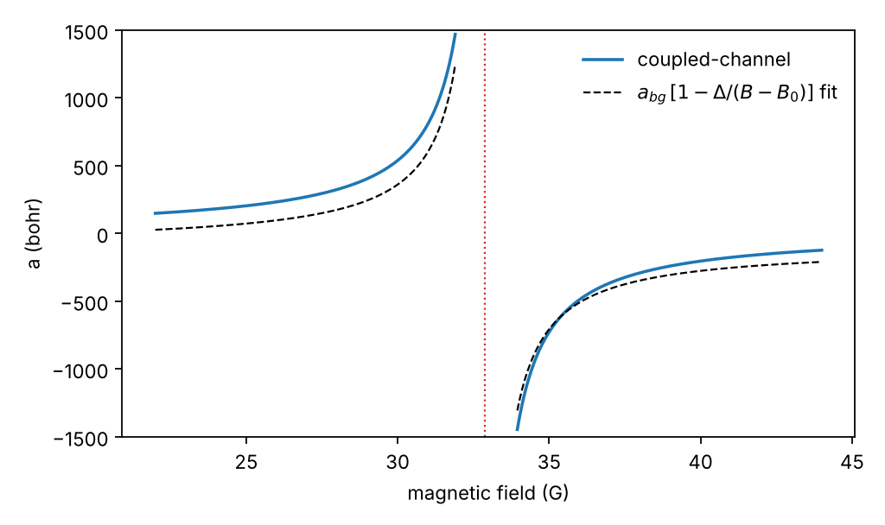

# coldscatter

**Coupled-channel scattering for ultracold atoms and molecules, in readable, tested, pure Python.**

`coldscatter` computes S/K matrices, scattering lengths, cross sections and Feshbach
resonances for two colliding particles, from a set of radial channels you define.
The goal is a community reference tool in the spirit of QuTiP and Pulser:
a small, well-documented API on top of a numerically validated core.

> **Status: v0.1 (pre-alpha).** The core solver has passed internal tests against
> analytical solutions and independent numerical integration references (see
> [Validation](#validation)). It has **not yet** been benchmarked against MOLSCAT
> or experimental scattering data for realistic atomic/molecular systems. External
> benchmarking is the first item on the [roadmap](docs/ROADMAP.md).
## Quick start

```bash
pip install -e ".[examples]"
```

```python
import coldscatter as cs
from coldscatter import units as u

mu = u.reduced_mass(87.0, 87.0)                       # atomic units
c6 = 4700.0
prob = cs.single_channel(mu, cs.LennardJones(c6, c6 * 11.0**6 / 2))
res = prob.solve(u.from_kelvin(1e-7), cs.Grid(r_min=4.0, r_max=1500.0, step=0.01))
print(res.scattering_length())      # complex, in bohr
print(res.cross_sections())
```

Magnetic Feshbach resonance, batched over the field (one sweep of the grid serves all fields):

```python
model = cs.two_channel_feshbach(mu, c6, c12_open=c6 * 11.0**6 / 2, c12_closed=c6 * 10.4**6 / 2,
                                coupling=2e-4, coupling_r0=11.0, coupling_sigma=1.5,
                                delta_mu=2 * u.MU_B_HARTREE_PER_GAUSS)
a = model.scan_field(B_gauss, u.from_kelvin(1e-7), cs.Grid(7.0, 800.0, 0.02))
a_bg, B0, delta = cs.fit_feshbach(B_window, a_window.real)
```




## What is inside

| module | role |
|---|---|
| `CoupledChannels` | N-channel radial problem: thresholds `E_i(B)`, potential matrix `V_ij(R)`, partial waves |
| `renormalized_numerov` | stable matrix propagator (Johnson 1977), fast scalar path, batched-over-field path |
| `asymptotics` | exact open/closed-channel matching with Riccati-Bessel functions, any `l` |
| `ScatteringResult` | `K`, `S`, complex scattering length, elastic/inelastic/total cross sections |
| `potentials`, `units` | Lennard-Jones, Gaussian, ..., vdW length and `a_bar`; atomic units, K, gauss |

Conventions and equations: [docs/PHYSICS.md](docs/PHYSICS.md).

## Validation

Run `pytest` (or `python tests/run_all.py` without pytest). The internal test suite checks:

- square well against the analytic scattering length (relative error ~1e-6)
- Lennard-Jones against an independent adaptive ODE solver (< 1e-4)
- Numerov fourth-order convergence in the step; `R_max^-3` tail error of the matching
- van der Waals universality: median `a` over short-range phases ~ Gribakin-Flambaum `a_bar`
- `sigma_el -> 4 pi |a|^2`; p-wave Wigner threshold law `tan(delta_1) ~ k^3`
- decoupled two-channel limit reproduces the single channel exactly
- coupled, open-closed, and propagation-matrix results against independent DOP853 ODE integration
- asymptotic matching and open/closed-channel derivative matching reference tests
- d- and f-wave threshold behaviour against independent numerical references
- S-matrix unitarity (1e-16), symmetry, optical theorem, batched scan = single solves
- Feshbach pole location and line-shape fit
- input validation for grids, potentials, channel definitions, and propagators

The Rb-87 literature tests currently check van der Waals length, energy, and
mean-scattering-length scales derived from published constants. They do not
constitute a full scattering-observable benchmark against experiment or MOLSCAT.
The DOP853 tests provide independent integration references for selected model
problems, not external validation of a realistic atomic or molecular system.

## Known limitations (v0.1)

- Uniform radial grid; the step is set by the shortest local wavelength.
- Matching at `R_max` uses free asymptotics, so the long-range `-C6/R^6` tail leaves an
  error that decreases like `R_max^-3`. Always check `R_max` convergence.
- You supply the channel basis by hand: `coldscatter.atomic` builds the single-atom hyperfine + Zeeman Hamiltonian only; there is no two-atom basis, singlet/triplet projector or rotor builder yet. `scattering_length()` returns the energy-dependent a(k) = -tan(delta)/k, so use a collision energy with k|a| << 1 for the zero-energy value.
- The Feshbach fit assumes a constant background and a single resonance.

## Contributing

Issues and PRs are welcome, especially validation cases against published results and
MOLSCAT output. See [docs/ROADMAP.md](docs/ROADMAP.md).

## Authorship and AI assistance

Developed and maintained by Mahdiyeh Ghasemi, with the assistance of Claude (Anthropic) as an AI coding support tool.

The scientific direction, implementation decisions, physics review, and evaluation of numerical methods are led by the project maintainer. Independent verification and validation against analytical solutions, established numerical methods, and published physical results are ongoing.

## License

MIT.
