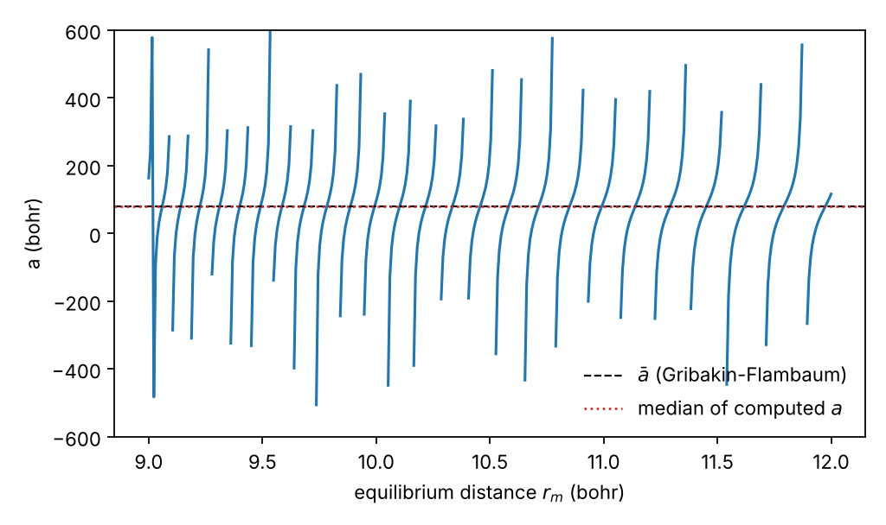

# Coldscatter

**Coupled-channel scattering for ultracold atoms and molecules, implemented in a readable, tested Python package.**

`coldscatter` computes K and S matrices, scattering lengths, cross sections and
magnetic Feshbach resonances for two colliding particles, from a set of radial
channels you define. It is a small, documented API (NumPy + SciPy) on top of a
numerically validated core, in the spirit of QuTiP and Pulser.

## Installation

```bash
git clone https://github.com/mahdiyeh-ghasemi/Coldscatter.git
cd Coldscatter
python -m pip install -e ".[examples]"      # core needs only numpy and scipy
```

Python 3.10 or newer.

## Quick start

Single channel, scattering length at 100 nK:

```python
import coldscatter as cs
from coldscatter import units as u

mu = u.reduced_mass(87.0, 87.0)                       # atomic units
c6 = 4700.0
prob = cs.single_channel(mu, cs.LennardJones(c6, c6 * 11.0**6 / 2))
res = prob.solve(u.from_kelvin(1e-7), cs.Grid(r_min=4.0, r_max=1500.0, step=0.01))
print(res.scattering_length())      # complex, in bohr
print(res.cross_sections(identical="bosons"))
```

For long ranges, use a fine step through the well and a coarse step outside it:

```python
grid = cs.Grid(r_min=4.0, r_max=1500.0, step=0.01, r_mid=40.0, step_long=0.5)
```

Magnetic Feshbach resonance, batched over the field (one sweep of the grid serves all fields):

```python
import numpy as np
import coldscatter as cs
from coldscatter import units as u
mu = u.reduced_mass(87.0, 87.0)
c6 = 4700.0

model = cs.two_channel_feshbach(mu, c6, c12_open=c6 * 11.0**6 / 2, c12_closed=c6 * 10.4**6 / 2,
                                coupling=2e-4, coupling_r0=11.0, coupling_sigma=1.5,
                                delta_mu=2 * u.MU_B_HARTREE_PER_GAUSS)
B_gauss = np.linspace(20.0, 45.0, 251)
a = model.scan_field(B_gauss, u.from_kelvin(1e-7), cs.Grid(7.0, 800.0, 0.02))
print(a)  # complex scattering length in bohr

# Fit one isolated resonance on a narrow field window around it:
# a_bg, B0, delta = cs.fit_feshbach(B_window, a_window.real)
```




## How it works

1. **Model.** `CoupledChannels` holds the radial coupled equations
   `psi'' = W(R) psi` with
   `W_ij = l_i(l_i+1)/R^2 delta_ij + 2 mu [V_ij(R) + (E_i(B) - E) delta_ij]`:
   channel thresholds `E_i(B)` (constant or field dependent), a symmetric
   potential matrix `V_ij(R)` and a partial wave per channel.
2. **Propagation.** The log-derivative matrix `Y = psi' psi^-1` is propagated
   outward from a hard wall at `r_min` with Johnson's log-derivative method
   (fourth order in the step, stable for closed channels). A grid can have one
   or two uniform sectors. Field scans propagate all fields in one batched
   sweep. A renormalized Numerov propagator is available as
   `propagator="numerov"`.
3. **Matching.** At `r_max`, `Y` is matched to Riccati-Bessel functions in open
   channels and decaying functions in closed channels, giving the K matrix and
   `S = (1 + iK)(1 - iK)^-1`. Optionally, a diagonal long-range tail
   `-sum C_n / R^n` (`LongRange`) is used for the reference functions.
4. **Observables.** `ScatteringResult` gives K and S, the energy-dependent
   complex scattering length `a(k) = (1 - S_ii) / (i k (1 + S_ii))`, and
   elastic, inelastic, loss and total cross sections (distinguishable or
   identical bosons/fermions).

Equations and conventions: [docs/PHYSICS.md](docs/PHYSICS.md). Full guide: [User manual](MANUAL.md).

## What is inside

| module | role |
|---|---|
| `CoupledChannels`, `Grid` | N-channel radial problem and its one- or two-sector radial grid |
| `propagators` | Johnson log-derivative propagator (default) and renormalized Numerov, both with a batched-over-field path |
| `asymptotics` | free or diagonal long-range reference matching, open and closed channels |
| `ScatteringResult` | `K`, `S`, complex scattering length, cross sections |
| `models` | single-channel and two-channel Feshbach model builders |
| `analysis` | Feshbach line shape and fit |
| `atomic` | single-atom hyperfine + Zeeman Hamiltonian, presets for 6Li, 23Na, 40K, 85Rb, 87Rb, 133Cs |
| `potentials`, `units` | Lennard-Jones, Gaussian, exponential, custom callables, vdW length and `a_bar`; atomic units, kelvin, gauss |
| `plotting` | scattering-length and cross-section plots, CSV export |

## Long-range reference matching

For a known diagonal tail, specify an explicit reference without adding it
again to the physical potential:

```python
tail = cs.LongRange({6: c6}, r_far=5000.0)
model = cs.CoupledChannels(mu, [0.0], [[cs.LennardJones(c6, c6 * 11.0**6 / 2)]], long_range=tail)
```

Coefficients are in atomic units. See the [User manual](MANUAL.md) for
channel-specific tails and convergence checks.

## Plotting and data export

```python
cs.plot_scattering_length(results, x="field", save="scattering_length.png")
cs.plot_cross_sections(results, x="field", save="cross_sections.png")
cs.export_results_csv(results, "scan_results.csv")
```

Plotting needs the optional Matplotlib dependency (`pip install -e ".[examples]"`).

## Validation

Run `pytest`. The test suite checks the solver against:

- analytic results: square-well scattering length, free-wave Wronskians, Wigner
  threshold laws for s-, p-, d- and f-waves, `sigma_el -> 4 pi |a|^2`
- independent adaptive ODE integration (DOP853) for single-channel, coupled,
  open-closed and long-range reference problems
- **MOLSCAT 2025.0** on an identical two-channel Lennard-Jones model
  ([benchmarks/molscat](benchmarks/molscat/)): S matrix within 6e-8, closed-channel
  resonance within 1.2e-7 away from the pole, near-threshold scattering length
  within 7e-9
- van der Waals universality (median `a` ~ Gribakin-Flambaum `a_bar`) and published
  87Rb van der Waals scales
- internal consistency: fourth-order step convergence, S-matrix unitarity and
  symmetry, optical theorem, batched scans equal to single solves, Feshbach pole
  and line-shape fit, hyperfine splittings of the alkali presets

Details: [docs/VALIDATION_STATUS.md](docs/VALIDATION_STATUS.md).

## Scope and limitations

- The channel basis is supplied by the user; `coldscatter.atomic` builds
  single-atom hyperfine + Zeeman Hamiltonians, but a two-atom pair basis with
  singlet/triplet potentials is not built in yet.
- Long-range reference tails are diagonal; off-diagonal long-range couplings are
  not supported. Check convergence with `r_max` (and `r_far` with `LongRange`).
- `scattering_length()` is energy dependent; use `k|a| << 1` for the zero-energy value.
- The Feshbach fit assumes a constant background and a single resonance.

Planned work: [docs/ROADMAP.md](docs/ROADMAP.md).

## Contributing

Issues and pull requests are welcome, especially validation cases against
published results and MOLSCAT output.

## Citation

If you use Coldscatter in research, cite the software version and the
underlying physical methods and data sources. See
[CITATION.cff](CITATION.cff) and [docs/CITATION_AND_COPYRIGHT.md](docs/CITATION_AND_COPYRIGHT.md).

## Author

Developed and maintained by Mahdiyeh Ghasemi.

## License

MIT.
